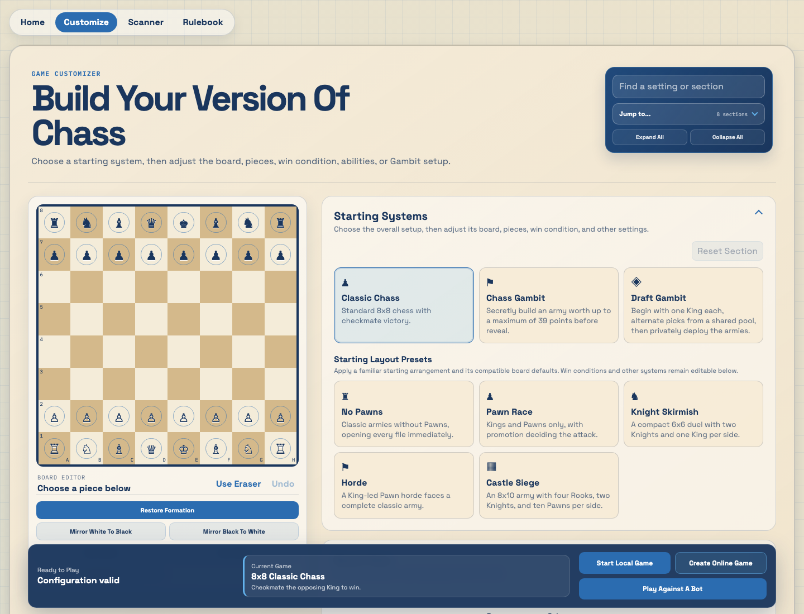
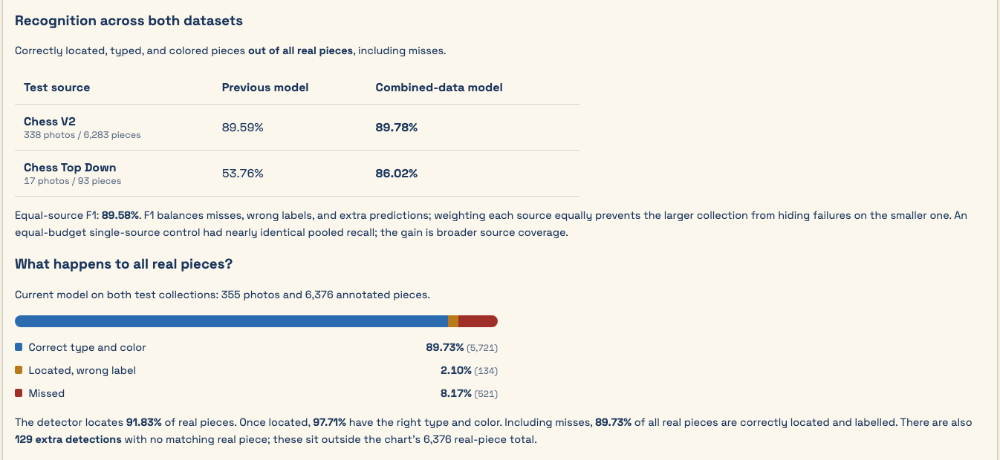
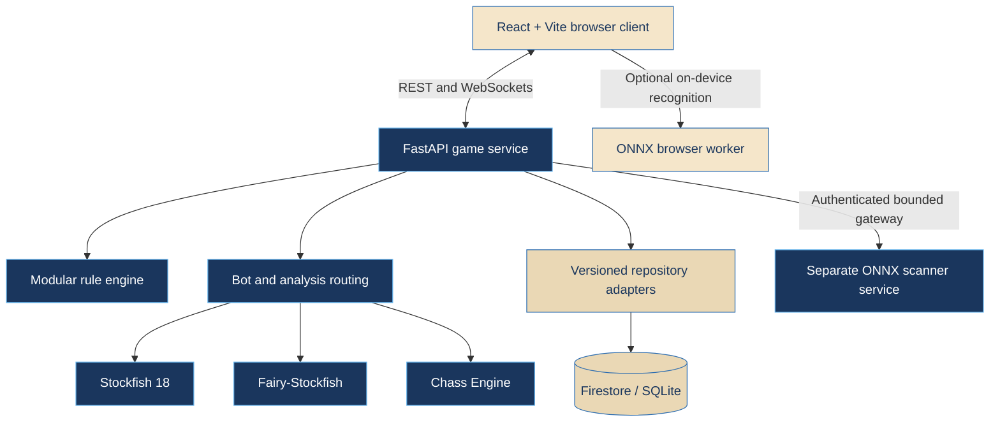

# Chass!

**Full-Stack AI Chess Platform**

Classic chess, configurable variants, and a computer-vision scanner that turns physical-board photos into playable games. Built with Python, FastAPI, React, and three interchangeable chess engines.

[Play Chass!](https://playchass.vercel.app) · [Board Scanner](https://playchass.vercel.app/scanner) · [Rulebook](https://playchass.vercel.app/rulebook)

## Features

- **Build your own chess:** 4x4 to 16x16 boards, editable layouts, seven custom pieces, seven special abilities, alternate win conditions, and hidden-army Gambit setups.
- **Play locally, online, or against bots:** private invite links/codes, real-time WebSocket synchronization, reconnect recovery, and engine-routed difficulty profiles.
- **Analyze positions:** Stockfish 18, Fairy-Stockfish, and the custom Chass Engine cover standard chess through custom variants.
- **Continue a physical game:** upload or photograph a board, review AI-recognized pieces, correct uncertain squares, and continue locally or online.

## AI Board Scanner

A two-stage vision pipeline combines an **SSDLite detector** with a **fine-tuned ResNet18 classifier**. Models train in PyTorch and run through ONNX Runtime on the server or optionally in a browser worker. Recognition is followed by human review, not treated as an automatically correct board.

### Evaluation, Not Just a Demo

The current models combine **Chess V2 + Chess Top Down**, with label corrections, deduplication, capture-grouped splits, and validation-selected thresholds. An equal-training-budget comparison measures whether merging data improves source coverage rather than simply benefiting from more training.

- **89.73%** of **6,376 annotated pieces across 355 benchmark photos** were correctly located and classified by type and color, including missed pieces in the denominator.
- **86.02%** correct-piece recall on Top Down, compared with **58.06%** for the equal-budget single-source control; Chess V2 recall was **89.78%** versus **90.21%**.
- **89.58% equal-source typed F1**, compared with **76.34%** for that control. Equal weighting prevents the larger dataset from dominating the result.

*The screenshot compares the previous serving model with the merged model; the equal-budget control above is a separate experiment. Website screenshots captured November 16, 2026; benchmark results recorded November 8, 2026.*

**Limits:** these are piece-box metrics, not square-level or whole-board accuracy. Unfamiliar sets, crowded positions, and King/Queen/Bishop confusion remain challenges. The larger source primarily contains black/white pieces on green/white boards; generalization to unseen physical sets is not established. Users review all 64 squares before import.

[Controlled comparison](scanner/ml/benchmarks/merged-data-2026-11-08/README.md) · [Accuracy history](scanner/ml/ACCURACY_TRACKER.md) · [ML pipeline](scanner/ml/README.md) · [Quality and evaluation](scanner/QUALITY.md)

## Chess Engines & Bots

| Engine | Role | Approach |
| --- | --- | --- |
| **Stockfish 18** | Compatible standard-rule 8x8 positions | UCI integration and NNUE evaluation; difficulty-limited bots |
| **Fairy-Stockfish** | Supported static variants up to 10x12 | Deterministically generated variant profiles, checked against Chass legal moves and terminal outcomes |
| **Chass Engine** | Remaining valid custom configurations | Handcrafted evaluation, bounded alpha-beta and quiescence search; custom pieces, abilities, terrain, and objectives |

The custom evaluator considers behavior-based material, King safety, activity, center control, objective progress, and live special resources. It is a heuristic engine, not a trained neural network; its analysis and bot strength are approximate.

Engine suggestions never bypass the rules: bot actions are revalidated before committing. Analysis runs asynchronously, is cached by engine and game state, and is version-checked before reaching the UI. Duplicate connections cannot schedule duplicate bot turns for the same game version.

[Analysis architecture](docs/MATCH_ANALYSIS.md) · [Bot routing and difficulty](docs/BOTS.md)

## Architecture

The backend owns move legality and versioned state updates. Seat-specific views keep Gambit deployments private until both players lock in. Repository adapters separate persistence from rules, and inactive-game cleanup removes associated seats, invites, and move records. Scanner inference is isolated from the game server so ML dependencies do not burden ordinary gameplay.

## Tech Stack

| Area | Tools |
| --- | --- |
| Frontend | JavaScript, React, Vite, CSS, WebSockets |
| Backend | Python, FastAPI, Pydantic, Uvicorn |
| Computer vision | PyTorch, torchvision, SSDLite, ResNet18, ONNX Runtime, NumPy, Pillow |
| Chess AI | Stockfish 18, Fairy-Stockfish, UCI, custom alpha-beta search |
| Persistence | Firestore, Firebase Admin SDK, SQLAlchemy, SQLite |
| Verification | Pytest, Hypothesis, python-chess differential tests, Playwright, HTTPX, Ruff, GitHub Actions |
| Hosting | Vercel, Render, Firebase |

## Documentation

- [Engineering decisions and tradeoffs](docs/ENGINEERING.md)
- [Development & operations](docs/DEVELOPMENT.md): local setup, tests, API, environment variables, and deployment
- [Verification evidence](docs/VERIFICATION.md)
- [Scanner workspace and dataset preparation](scanner/README.md)

### Training Data Credits

- **Current scanner:** [Chess V2 by Public Wspace](https://universe.roboflow.com/public-wspace/chess-v2-qqtmk), Roboflow Universe, 2022, [CC BY 4.0](https://creativecommons.org/licenses/by/4.0/). Chass removed duplicate photos, corrected labels and orientation, and grouped related captures before splitting for training and evaluation.
- **Current scanner:** [Chess Top Down by chess](https://universe.roboflow.com/chess-gftva/chess-top-down), Roboflow Universe, 2022, [CC BY 4.0](https://creativecommons.org/licenses/by/4.0/). Combined with Chess V2 through a versioned merge that preserves original files and excludes cross-split overlap. Also used for the initial baseline.
