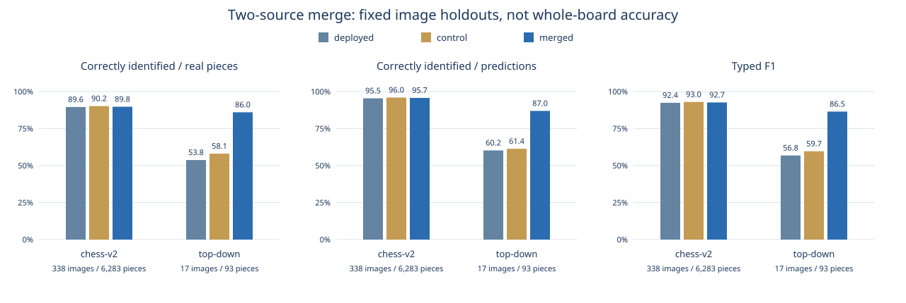

# Combined-Dataset Results

Recorded November 8, 2026. See [the preregistered protocol](PROTOCOL.md) for selection rules and limitations.

| Model | Source | Correct / real pieces | Correct / predictions | Typed F1 | Missed | Extra |
| --- | --- | ---: | ---: | ---: | ---: | ---: |
| deployed | chess-v2 | 89.59% | 95.47% | 92.44% | 536 | 149 |
| deployed | top-down | 53.76% | 60.24% | 56.82% | 18 | 8 |
| control | chess-v2 | 90.21% | 95.99% | 93.01% | 506 | 128 |
| control | top-down | 58.06% | 61.36% | 59.67% | 15 | 10 |
| merged | chess-v2 | 89.78% | 95.74% | 92.67% | 514 | 123 |
| merged | top-down | 86.02% | 86.96% | 86.49% | 7 | 6 |

## Primary Comparison

- deployed: equal-source mean typed F1 **74.63%**; pooled correctly identified / real pieces **89.07%**.
- control: equal-source mean typed F1 **76.34%**; pooled correctly identified / real pieces **89.74%**.
- merged: equal-source mean typed F1 **89.58%**; pooled correctly identified / real pieces **89.73%**.

Paired source-group bootstrap, merged minus control: **+8.78 to +18.56 percentage points** (95% percentile interval, 2,000 resamples).
Only three Chess V2 test groups and 17 Top Down image groups are available. This interval does not account for multiple training seeds or prove physical-set independence.

## Decision

Accuracy gate passed: **True**.

The accuracy gate is separate from deployment readiness. Completed post-selection checks are recorded below when available.
Deployed models and website metrics are unchanged by this experiment.

## Post-Selection Runtime Checks

ONNX parity passed: **True** on 40 validation photos, spread within each source. Board/review decisions and top-three labels were compared against PyTorch CPU inference.
Maximum score difference: 0.00000650; maximum box-coordinate difference: 0.00024414 pixels. This checks export consistency, not independent accuracy.

Details: [onnx-parity.json](onnx-parity.json).

Local CPU runtime (one fresh process per model, batch size one):

| Model | Photos | Median | p95 | Peak process memory |
| --- | ---: | ---: | ---: | ---: |
| `scanner/models/onnx` | 40 | 136.2 ms | 230.0 ms | 443.2 MiB |
| `scanner/artifacts/merged-onnx-2026-11-08` | 40 | 139.8 ms | 222.3 ms | 442.6 MiB |

Both models received the same validation photos. These are single-run Mac CPU measurements, not Render cold-start, browser, upload, or end-to-end website latency. Small timing differences are not evidence of a speed improvement. The runtime subset is not the accuracy test benchmark.

Measurements and sampled image IDs: [runtime.json](runtime.json). Candidate ONNX files remain local; browser and hosted integration checks are required before public promotion.

## Scope

Both detector and classifier were fine-tuned in both arms from identical existing checkpoints, with equal optimizer-update budgets. This is a single-seed continuation experiment, not a claim that all possible mixed-data training recipes perform similarly.

These are box-level regression metrics. Different source images provide a limited source-shift check, not independently verified unseen-board generalization. No whole-board or empty-square accuracy is available. Follow-up work requires new physical sets with all 64 squares verified.

Full class/confusion metrics, model hashes, validation choices and decision gates: [results.json](results.json). Plot-ready values: [metrics.csv](metrics.csv). Training budgets/history: [training.json](training.json).
